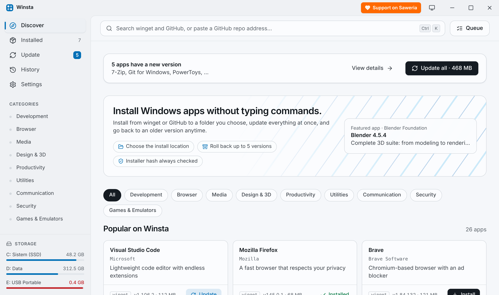
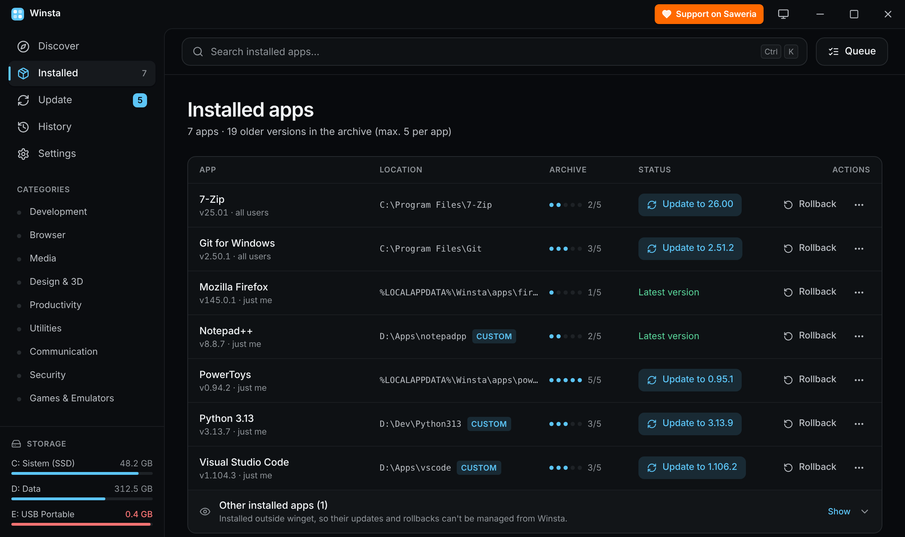
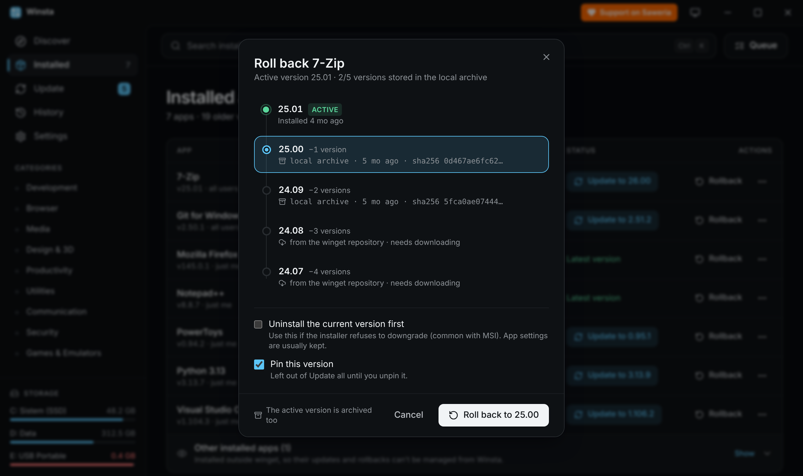

<p align="center">
  
</p>

<h1 align="center">📦 Winsta — Install, Update & Roll Back Windows Apps</h1>

<p align="center">
  <b>A friendly app manager for Windows, built on winget and GitHub Releases.</b><br/>
  <i>Choose where every app is installed, update everything in one click, and go back up to 5 versions when an update breaks something.</i>
</p>

<p align="center">
  <a href="https://github.com/savoreux"></a>
  <a href="https://saweria.co/davidhandy"></a>
  <a href="https://github.com/savoreux/winsta/releases/latest"></a>
  <a href="https://github.com/savoreux/winsta/releases"></a>
  <a href="LICENSE"></a>
  
  
</p>

<p align="center">
  <a href="https://github.com/savoreux/winsta/releases/latest"><b>⬇️ Download Winsta</b></a> ·
  <a href="https://savoreux.github.io/winsta/"><b>🌐 Website</b></a> ·
  <a href="#-quick-start">🚀 Quick start</a> ·
  <a href="#-features">✨ Features</a> ·
  <a href="#-privacy--clean-uninstall">🔒 Privacy</a>
</p>

<p align="center">
  
</p>

---

## ✨ Features

| | Feature | What it does |
| :---: | --- | --- |
| 📁 | **Choose install location** | Install apps to the default Winsta folder or any folder you pick, for example drive `D:` to save space on your system SSD. Winsta shows whether each installer type supports a custom location and checks free disk space first. |
| 🔄 | **Update on launch** | Winsta checks for updates when you open it. No background process, no system tray icon. New versions show up as a number on the Update menu. |
| ⏪ | **Roll back up to 5 versions** | Go back to an earlier version from the winget repository or GitHub releases, and pin it so Update all leaves it alone. |
| 🐙 | **Install from GitHub** | Search GitHub or paste a repo address. Winsta picks the right Windows file (MSI, setup .exe, or portable .zip), checks its SHA-256 hash, and installs it. |
| 🧹 | **Clean uninstall** | After the uninstaller finishes, Winsta checks the app is really gone, then offers to delete leftover folders, AppData, and shortcuts. |
| 🔍 | **One search box** | Searches winget and GitHub on Discover, and filters the list on Installed, Updates, and History. |
| 🛡️ | **Hash always checked** | winget verifies every installer against its manifest; GitHub downloads are checked against the hash GitHub records. |
| 🌗 | **Light, dark, or follow Windows** | Mica effect on Windows 11, theme switches instantly when Windows does. |
| 🌐 | **Indonesian & English** | Pick the language in Settings → Appearance. |

<table>
  <tr>
    <td></td>
    <td></td>
  </tr>
  <tr>
    <td align="center"><sub>Installed apps, with location and status</sub></td>
    <td align="center"><sub>Roll back to any of the last 5 versions</sub></td>
  </tr>
</table>

## ⌨️ Keyboard Shortcuts

| Shortcut | Action |
| :---: | --- |
| <kbd>Ctrl</kbd> + <kbd>K</kbd> | Focus the search box |
| <kbd>Ctrl</kbd> + <kbd>1</kbd> … <kbd>5</kbd> | Discover · Installed · Update · History · Settings |
| <kbd>Ctrl</kbd> + <kbd>Enter</kbd> | Install from the install dialog |
| <kbd>Esc</kbd> | Clear the search or close a dialog |

## 🚀 Quick Start

### Requirements / Kebutuhan
- **Windows 10 (1809+) or Windows 11**, 64-bit.
- **winget (App Installer)** — sudah bawaan Windows 11 dan Windows 10 terbaru. Cek dengan membuka PowerShell lalu ketik `winget --version`. Kalau belum ada, pasang **App Installer** dari Microsoft Store.

### Option 1 — Installer `.msi` (recommended)
1. Download **`Winsta_x.y.z_x64_en-US.msi`** from the [latest release](https://github.com/savoreux/winsta/releases/latest).
2. Jalankan file-nya. Di halaman **Destination Folder**, klik **Change…** bila ingin memasang Winsta di drive lain.
3. Bila muncul **"Windows protected your PC"**, klik **More info → Run anyway**. Installer belum ditandatangani (code signing), jadi Windows belum mengenalinya.
4. Buka **Winsta** dari Start Menu. Saat pertama dibuka, Winsta memindai aplikasi yang sudah terpasang.

> 💡 **Tip:** Some installed apps not showing? Click **Install module** on the Installed page. It adds Microsoft's official **Microsoft.WinGet.Client** module (once, for your account only, no admin needed) so names and IDs are read in full.
>
> Ada aplikasi yang tidak muncul? Klik **Pasang modul** di halaman Terpasang.

### Option 2 — winget *(coming soon)*
```powershell
winget install Savoreux.Winsta
```
Available once the package is accepted into [microsoft/winget-pkgs](https://github.com/microsoft/winget-pkgs).

### Option 3 — Run from source
Butuh Rust dan Visual Studio Build Tools; Node.js tidak wajib.
```powershell
git clone https://github.com/savoreux/winsta.git
cd winsta
.\jalankan.bat          # open Winsta
.\buat-installer.bat    # build the .msi
```
Details: [DEVELOPMENT.md](DEVELOPMENT.md).

## 🔒 Privacy & Clean Uninstall

**Privacy policy.** This program will not transfer any information to other networked systems unless specifically
requested by the user or the person installing or operating it. Winsta only connects to the network when you use it:
- **winget** (Microsoft) runs to search, install, update, and uninstall apps.
- **api.github.com** is called when you search or install from GitHub. An optional GitHub token, if you add one in
  Settings, is stored only on your PC.
- **github.com** release files are downloaded when you install or update a GitHub app.

Winsta has **no analytics, no telemetry, no account**, and does not collect personal data.

**Uninstall Winsta.** Open **Windows Settings → Apps → Installed apps → Winsta → Uninstall**. Apps you installed
with Winsta stay installed.

**When Winsta uninstalls an app**, it:
1. runs the app's own uninstaller through winget (or deletes the folder, for portable GitHub apps);
2. rescans Windows — if the app is still there, offers to run the uninstaller with its own window;
3. lists leftover folders, AppData/ProgramData data, and shortcuts, and deletes only the ones you check.
   System folders and shared folders are never touched.

## 🏗️ Under the Hood

```
┌──────────────── Winsta (Tauri 2 window) ────────────────┐
│  React 19 + TypeScript + Tailwind CSS 4  (dist/)        │
│        │ invoke()                    ▲ progress events  │
│        ▼                             │                  │
│  Rust backend (src-tauri/src)                           │
│   ├─ winget.rs   → winget CLI / Microsoft.WinGet.Client │
│   ├─ github.rs   → download, SHA-256, MSI/Inno/NSIS     │
│   ├─ system.rs   → drives, install folders (registry)   │
│   └─ cleanup.rs  → leftover folders & shortcuts         │
└─────────────────────────────────────────────────────────┘
          │                                   │
     winget sources                 api.github.com / releases
```

1. On launch, Winsta reads installed apps (`winget list`), matches each with its folder in the Windows Uninstall
   registry, then checks for updates (`winget upgrade`).
2. Installs, updates, rollbacks, and uninstalls run one at a time in the **Queue**, with live progress from winget.
3. GitHub apps are tracked by Winsta itself, so they get updates and rollbacks too.

## 🔏 Code Signing Policy

Free code signing provided by [SignPath.io](https://about.signpath.io), certificate by [SignPath Foundation](https://signpath.org)
*(application pending — current releases are not yet signed)*.

- **Signed artifacts:** the Winsta installer (`Winsta_<version>_x64_en-US.msi`) and the `winsta.exe` it contains,
  published on the [Releases](https://github.com/savoreux/winsta/releases) page.
- **Build:** every release is built from this public repository by
  [`.github/workflows/release.yml`](.github/workflows/release.yml). Binaries built on personal machines are never signed.
- **Team roles:** committers, reviewers, and approvers — [savoreux](https://github.com/savoreux).
- **Approval:** every signing request is approved manually by an approver.
- **Account security:** all team members use multi-factor authentication on GitHub and SignPath.

Each release also ships `SHA256SUMS.txt` so you can verify your download.

## 💖 Support This Project

Winsta is free and always will be. If it saves you time, you can support development on Saweria:

<a href="https://saweria.co/davidhandy"></a>

Found a bug or have an idea? [Open an issue](https://github.com/savoreux/winsta/issues). Please follow the
[Code of Conduct](CODE_OF_CONDUCT.md).

## 📜 License & Credits

© 2026 Savoreux

Winsta is open-source software licensed under the **[GNU General Public License v3.0](LICENSE)**. You are free to use,
study, change, and share it. If you share a modified version, it must also be GPL-3.0, include its source code, and keep
the Savoreux copyright notice.

- Built on Microsoft's [winget](https://github.com/microsoft/winget-cli), [Tauri](https://tauri.app),
  [React](https://react.dev), and [Tailwind CSS](https://tailwindcss.com) — full list in
  [THIRD-PARTY-NOTICES.md](THIRD-PARTY-NOTICES.md).
- Built with the help of [Claude](https://claude.ai) by Anthropic.
- Official downloads are only available from this repository's [Releases](https://github.com/savoreux/winsta/releases) page.
